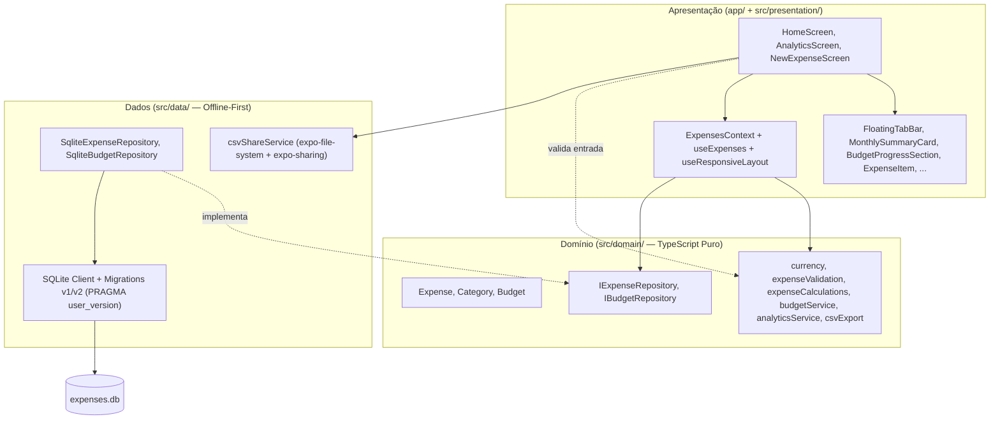
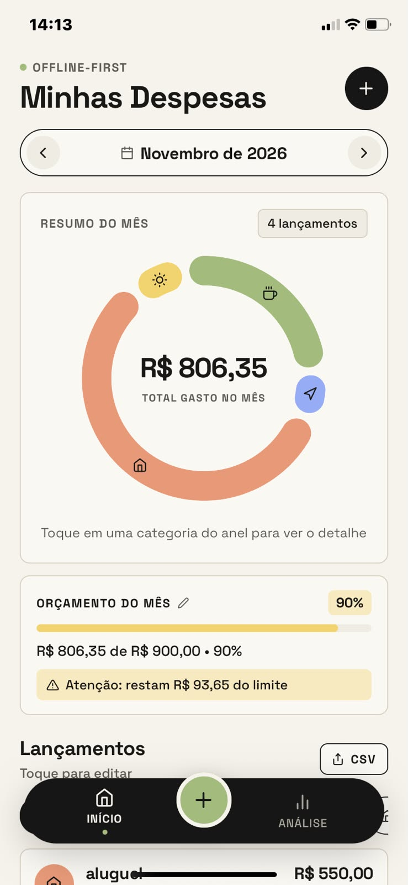
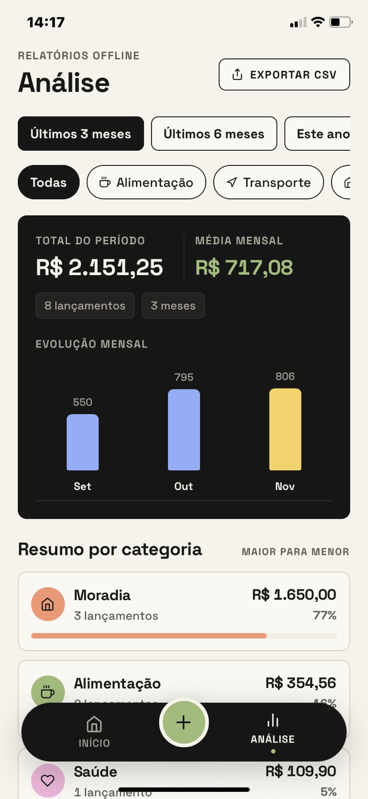

# Controle de Despesas (Offline-First)

Aplicativo mobile multiplataforma desenvolvido com **React Native + Expo** para controle pessoal de despesas **100% offline**, com persistência local em **SQLite**, arquitetura limpa em camadas, identidade visual editorial (**Eco-Fintech Editorial**), responsividade para celulares compactos e tablets, e cobertura de testes unitários com **Jest**.

---

## Visão Geral

O aplicativo foi projetado para funcionar integralmente sem conexão com a internet e sem dependência de back-end remoto. Todos os lançamentos e orçamentos mensais são armazenados localmente no dispositivo via `expo-sqlite`, garantindo acesso imediato, recálculo determinístico e privacidade total dos dados financeiros.

---

## Funcionalidades Implementadas

### Requisitos Obrigatórios do MVP (RF01 a RF07)

- [x] **RF01 — Cadastro:** Registro de despesas com descrição obrigatória, valor numérico estritamente `> 0`, data e categoria tipada.
- [x] **RF02 — Listagem:** Exibição clara de descrição, valor, data e categoria em cards horizontais legíveis, ordenados cronologicamente (mais recentes primeiro).
- [x] **RF03 — Resumo Mensal:** Cálculo exato e exibição do total gasto no mês selecionado com base na data de cada lançamento.
- [x] **RF04 — Filtros por Período:** Alternância entre meses e anos (`< Mês Ano >` + retorno rápido _"Atual"_), atualizando listagem, orçamento e resumo imediatamente.
- [x] **RF05 — Exclusão:** Remoção de despesas com diálogo de confirmação e recálculo instantâneo do total mensal e do gráfico.
- [x] **RF06 — Persistência e Navegação:** Persistência local em SQLite após fechar/reabrir o app sem internet, com navegação funcional via Expo Router entre as abas **Início**, **Análise** e a tela de **Nova/Editar Despesa**.
- [x] **RF07 — Validação:** Bloqueio de valores inválidos (zero, negativos, vazios ou não numéricos), datas inexistentes (ex.: `31/02`) e campos obrigatórios ausentes, com feedback visual inline em cada campo.

### Diferenciais e Evoluções Implementadas

- [x] **Edição de Despesa:** Toque em qualquer lançamento para abrir o formulário pré-preenchido, editar qualquer campo e atualizar imediatamente no SQLite.
- [x] **Gráfico Circular Interativo (Donut Segmentado):** Anel em `react-native-svg` exibindo apenas categorias com gasto `> R$ 0,00` no mês; tocar em qualquer segmento ou ícone exibe a barra de detalhe (`Categoria • R$ X,XX (Y%)`).
- [x] **Orçamento Mensal Opcional com Alertas:** Limite configurável por mês (`YYYY-MM`) persistido em SQLite, com barra de progresso em 3 níveis: **Verde Sálvia** (≤ 75%), **Mostarda** (76%–99% com aviso) e **Terracota** (≥ 100% com alerta de limite excedido).
- [x] **Filtro por Categoria na Tela Inicial:** Chips horizontais (_Todas_ + categorias) filtrando a listagem sem distorcer o resumo mensal.
- [x] **Barra de Navegação Inferior Flutuante:** Navegação limpa em pílula escura (`Início` • `+` • `Análise`) com data contextual automática ao adicionar a partir de outro mês.
- [x] **Tela de Análise por Período:** Filtros de período (_Últimos 3 meses_, _Últimos 6 meses_, _Este ano_, _Tudo_) combináveis com categoria, card com **Total do Período**, **Média Mensal**, gráfico de barras de evolução mensal e ranking decrescente por categoria.
- [x] **Exportação CSV Offline:** Geração de arquivos `.csv` com cabeçalho em português, escape RFC 4180 e BOM UTF-8 (compatível com Excel/Sheets), disponível tanto por mês na Tela Inicial (`despesas-YYYY-MM.csv`) quanto por período/categoria na Tela de Análise, usando o compartilhamento nativo do aparelho.
- [x] **Responsividade (Celulares Compactos e Tablets):** Adaptação via `useWindowDimensions()`, largura máxima centralizada (`maxWidth: 680`) em telas largas (`>= 600px`), escalonamento proporcional dos gráficos e `"supportsTablet": true` no iOS.
- [x] **Testes Unitários Automatizados:** 13 suítes e 67 testes cobrindo regras de domínio, cálculos, validações, CSV, migrações e repositórios SQLite.

---

## Tecnologias e Dependências

| Tecnologia / Biblioteca              | Versão (`package.json`) | Papel no Projeto                                              |
| :----------------------------------- | :---------------------- | :------------------------------------------------------------ |
| **Expo SDK**                         | `~58.0.26`              | Plataforma e toolchain React Native                           |
| **React Native**                     | `0.88.1`                | Framework mobile multiplataforma                              |
| **React**                            | `19.3.0`                | Biblioteca de interface                                       |
| **TypeScript**                       | `~6.0.3`                | Tipagem estática (`strict: true`)                             |
| **Expo Router**                      | `~58.0.32`              | Navegação baseada em arquivos (`app/`)                        |
| **expo-sqlite**                      | `~58.0.18`              | Banco de dados relacional local offline                       |
| **react-native-svg**                 | `15.16.0`               | Gráfico circular interativo (donut segmentado)                |
| **expo-file-system**                 | `~58.0.14`              | Geração local de arquivo CSV offline (`File` / `Paths`)       |
| **expo-sharing**                     | `~58.0.23`              | Gaveta nativa de compartilhamento para exportação CSV         |
| **expo-font**                        | `~58.0.12`              | Carregamento de fontes customizadas compatível com Expo Go    |
| **@expo-google-fonts/space-grotesk** | `^0.4.1`                | Tipografia geométrica unificada (`Regular`, `Medium`, `Bold`) |
| **@expo/vector-icons**               | `^15.0.2`               | Ícones geométricos nativos (Feather)                          |
| **Jest**                             | `~30.5.2`               | Runner de testes unitários                                    |
| **jest-expo**                        | `~58.0.15`              | Preset oficial de testes do ecossistema Expo                  |
| **eslint-config-expo**               | `~58.0.4`               | Lint oficial do Expo (Flat Config)                            |

---

## Arquitetura e Decisões Técnicas

O projeto adota uma **Arquitetura Limpa Pragmática** com separação estrita em três camadas, garantindo que nenhuma regra de negócio ou SQL resida em componentes visuais:



### Organização de Pastas

- **`app/`**: rotas finas do Expo Router (`_layout.tsx`, `(tabs)/_layout.tsx`, `(tabs)/index.tsx`, `(tabs)/analytics.tsx`, `new-expense.tsx`).
- **`src/domain/`**: TypeScript puro (zero imports de React Native/Expo) contendo entidades, portas de repositório, parser/formatador monetário, datas timezone-safe, validação, cálculos mensais, regras de orçamento, agregação analítica e formatação CSV.
- **`src/data/`**: cliente singleton `openDatabaseAsync('expenses.db')`, migrações versionadas (`PRAGMA user_version` v1 → v2 criando `expenses` e `monthly_budgets`), mapeador `ExpenseRow ↔ Expense`, repositórios SQLite parametrizados e adaptador de compartilhamento CSV.
- **`src/presentation/`**: tema centralizado (`theme.ts`), contexto reativo (`ExpensesContext`), hooks (`useExpenses`, `useResponsiveLayout`), componentes modulares e telas.
- **`__tests__/`**: suíte Jest espelhando `domain/` e `data/`.

### Justificativa das Principais Decisões

1. **Valores monetários em centavos inteiros (`INTEGER`):** elimina erros de ponto flutuante (`0.1 + 0.2 !== 0.3`) em somas, médias e percentuais.
2. **Datas em ISO local (`YYYY-MM-DD`):** evita deslocamento de fuso horário que moveria despesas de início/fim de mês para o mês errado.
3. **Migrações versionadas com `PRAGMA user_version`:** evolução segura e idempotente do schema offline (`v1`: tabela `expenses` + índice `idx_expenses_date`; `v2`: tabela `monthly_budgets`), com constraints `CHECK (... > 0)` como defesa em profundidade.
4. **Injeção de `SQLiteExecutor`:** os repositórios recebem uma interface enxuta satisfeita estruturalmente pelo `SQLiteDatabase`, permitindo testes unitários rápidos e confiáveis sem acoplamento nativo.
5. **Tipografia unificada (`Space Grotesk`) + `tabular-nums`:** mantém identidade geométrica coerente em toda a interface com alinhamento numérico vertical perfeito em valores, datas e percentuais.

---

## Como Executar e Testar

### Pré-requisitos

- **Node.js 20+** e **npm** (testado com Node `v24.18.0` e npm `11.16.0`).
- Aplicativo **Expo Go** instalado no dispositivo Android/iOS (ou emulador configurado).

### 1. Clonar e instalar dependências

```bash
git clone <URL_DO_REPOSITORIO>
cd loadingps
npm install
```

### 2. Rodar o aplicativo no Expo Go

```bash
npx expo start
```

_(Caso o firewall da rede local bloqueie a conexão com o celular, utilize `npx expo start --tunnel`.)_

### 3. Executar testes, checagem de tipos e lint

```bash
# Testes unitários (Jest)
npm test

# Checagem estática de tipos (TypeScript strict)
npx tsc --noEmit

# Linter oficial do Expo
npm run lint
```

---

## Capturas de Tela

|                   Tela Inicial                  |                   Editar Despesa                  |             Tela de Análise por Período             |
| :---------------------------------------------: | :-----------------------------------------------: | :-------------------------------------------------: |
|  |  |  |

---

## Transparência sobre o Uso de Inteligência Artificial

Este projeto foi desenvolvido com o apoio de **inteligência artificial como ferramenta de engenharia assistida** nas etapas de planejamento arquitetural, estruturação em fases incrementais, geração guiada de código, criação de testes unitários em TDD, revisão de responsividade e redação de documentação técnica.

Todas as decisões de produto, identidade visual, revisões de código, testes práticos no dispositivo real via **Expo Go**, validações automatizadas (`npx tsc --noEmit`, `npm run lint` e `npm test`) e aprovações de cada commit incremental foram conduzidas e validadas manualmente ao longo do desenvolvimento.
