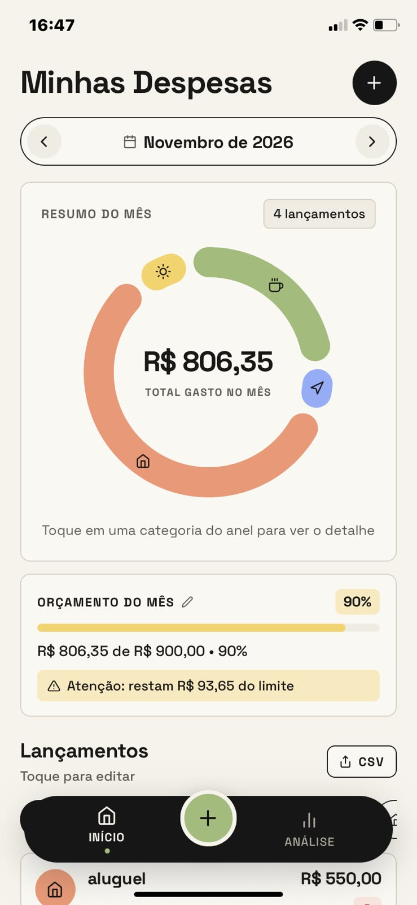
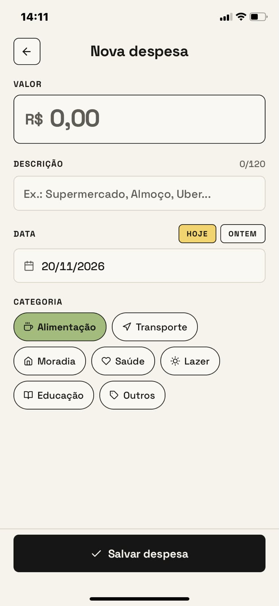
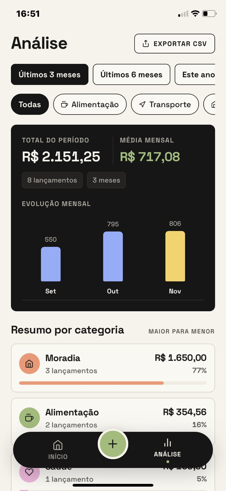

# Controle de Despesas (Offline-First)

Aplicativo mobile de controle de despesas pessoais desenvolvido com **React Native + Expo**, funcionando **100% offline** com persistência local em **SQLite**. O projeto separa domínio, dados e interface em camadas independentes, com valores armazenados em centavos inteiros e cobertura de testes unitários com Jest.

## Capturas de Tela

|                    Início                     |               Nova / Editar Despesa               |                       Análise                        |
| :-------------------------------------------: | :-----------------------------------------------: | :--------------------------------------------------: |
|  |  |  |

## Funcionalidades

### Obrigatórias (RF01–RF07)

- **RF01 — Cadastro:** registro de despesa com descrição obrigatória, valor numérico estritamente maior que zero, data e categoria.
- **RF02 — Listagem:** exibição cronológica (mais recentes primeiro) com descrição, valor, data e categoria.
- **RF03 — Resumo mensal:** cálculo e exibição do total gasto no mês selecionado.
- **RF04 — Filtro por mês/ano:** alternância imediata entre períodos atualizando lista, resumo e orçamento.
- **RF05 — Exclusão:** remoção com diálogo de confirmação e recálculo imediato do total.
- **RF06 — Persistência e navegação:** dados salvos localmente em SQLite (persistem sem internet) e navegação via Expo Router.
- **RF07 — Validação:** bloqueio de campos ausentes, valores inválidos (zero, negativos ou texto) e datas inexistentes com mensagens inline.

### Opcionais implementadas

- Edição de despesa ao tocar em qualquer lançamento da lista.
- Gráfico circular interativo (donut) exibindo apenas categorias com gasto no mês, com detalhe por categoria ao tocar.
- Filtro horizontal por categoria na tela inicial (sem alterar o resumo do mês).
- Orçamento mensal opcional (SQLite) com barra de progresso em 3 níveis (normal ≤ 75%, atenção 76%–99% e excedido ≥ 100%).
- Tela de Análise por período (_3 meses_, _6 meses_, _Este ano_ e _Tudo_), média mensal, gráfico de evolução e ranking de categorias.
- Exportação offline de relatório em **CSV** (mensal na tela inicial e filtrado na tela de análise) via compartilhamento nativo.
- Layout responsivo para celulares compactos e tablets (`maxWidth` centralizado e `supportsTablet: true`).

## Stack e Estrutura

- **Core:** Expo `~58.0.26`, React Native `0.88.1`, React `19.3.0`, TypeScript `~6.0.3` (`strict`)
- **Navegação e UI:** Expo Router `~58.0.32`, `react-native-svg` `15.16.0`, `@expo/vector-icons`, `Space Grotesk` (`expo-font`)
- **Offline e Exportação:** `expo-sqlite` `~58.0.18`, `expo-file-system` `~58.0.14`, `expo-sharing` `~58.0.23`
- **Qualidade:** Jest `~30.5.2`, `jest-expo` `~58.0.15`, `eslint-config-expo` `~58.0.4`

```text
├── app/                     # Rotas finas do Expo Router ((tabs) e new-expense)
├── src/
│   ├── domain/              # Entidades, validações, cálculos, orçamento, análise e CSV (TS puro)
│   ├── data/                # Cliente SQLite, migrações v1/v2, repositórios e exportação CSV
│   └── presentation/        # Tema, contexto, hooks responsivos, componentes e telas
├── __tests__/               # 13 suítes / 67 testes unitários (domínio e dados)
└── docs/screenshots/        # Capturas reais do aplicativo
```

## Como Executar e Testar

Pré-requisitos: **Node.js 20+** e o app **Expo Go** no celular (ou emulador Android/iOS).

```bash
# 1. Instalar dependências
npm install

# 2. Iniciar no Expo Go (use --tunnel se o firewall bloquear a rede local)
npx expo start

# 3. Executar testes unitários e checagem de tipos
npm test
npx tsc --noEmit
```

## Uso de Inteligência Artificial

Este projeto contou com o apoio de inteligência artificial como acelerador de engenharia no planejamento arquitetural, escrita guiada de código e criação de testes unitários, conduzido em um fluxo estruturado de entregas incrementais com controle total sobre o produto:

- **Direção técnica e visual:** definição da arquitetura em camadas (`domain`, `data`, `presentation`), modelagem offline em SQLite e curadoria de UI/UX com referências próprias.
- **Senso crítico em testes reais:** validação contínua no dispositivo via Expo Go, resultando em ajustes e descartes conscientes a cada entrega — como a remoção de gestos que prejudicavam a fluidez, correção de truncamento nos cards, unificação tipográfica e data contextual.
- **Revisão e qualidade:** todas as entregas passaram por revisão manual de código antes de cada commit, além de validações em terminal (`tsc --noEmit`, `lint`) e testes unitários automatizados cobrindo as regras de negócio.
